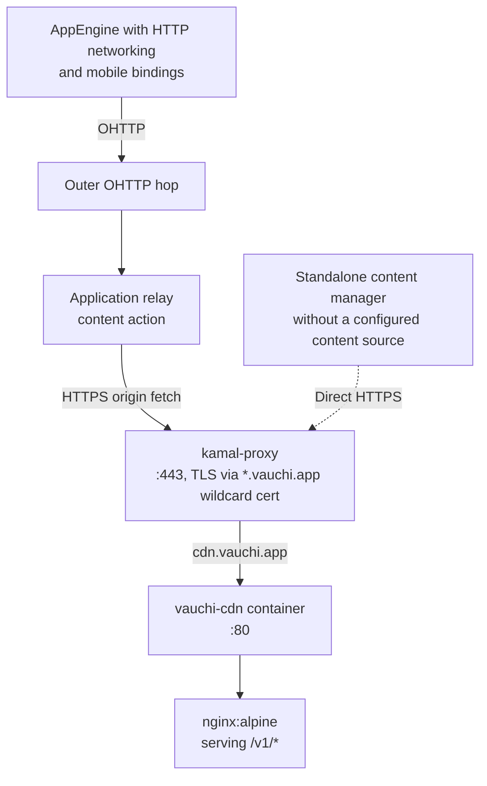
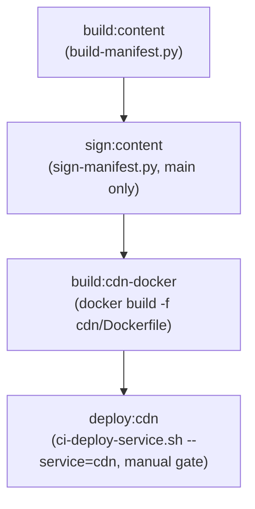

<!-- SPDX-FileCopyrightText: 2026 Mattia Egloff <mattia.egloff@pm.me> -->
<!-- SPDX-License-Identifier: GPL-3.0-or-later -->

# cdn.vauchi.app Setup

The content server (CDN) serves themes, languages and their signed file list.
It runs in Docker behind kamal-proxy.

## Architecture



Mobile apps and AppEngine builds with HTTP support fetch files through
two relay hops. This uses Oblivious HTTP (OHTTP) and the relay's `content`
action. The relay fetches each file from the CDN and keeps it in a short
cache.

A `ContentManager` can also run on its own. Without a content source
set, it fetches files straight from the CDN. On both paths, the client
checks the signed file list (manifest). It then checks each file's
checksum. This confirms that the bytes match that list.

> **Privacy note:** The outer hop sees your network address. The app's
> relay sees which files you ask for. Vauchi runs both hops today. It
> could link your address to those requests. The CDN sees the relay's
> fetches on this path. If a content manager fetches files directly,
> the CDN sees its address and the file paths it asks for. See the
> [Roadmap](https://docs.vauchi.app/roadmap.html) for separate operation
> of the outer hop.

Content is baked into the Docker image at build time (same pattern as
the landing page). Each content update produces a new image tag →
deploy via `ci-deploy-service.sh`.

## DNS

Point `cdn.vauchi.app` at the host serving the CDN container.

The wildcard `*.vauchi.app` TLS cert already covers this subdomain.
kamal-proxy volume mounts handle cert provisioning — no certbot needed.

## Content Signing (One-Time)

```bash
pip install PyNaCl
python scripts/sign-manifest.py --generate-key --key-dir keys/
```

Store as GitLab CI variables:

- `CONTENT_SIGNING_KEY` (protected, masked) — base64 Ed25519 private key
- Embed `keys/content-signing.pub` in vauchi-core for client verification

**NEVER commit `keys/content-signing.key` to git.**

## CI Pipeline

The website CI builds and deploys the CDN image:



## GitLab CI Variables

| Variable | Scope | Protected | Masked |
|----------|-------|-----------|--------|
| `CONTENT_SIGNING_KEY` | website | yes | yes |

Configure `DEPLOY_SSH_PRIVATE_KEY` and `DEPLOY_HOST` as protected CI
variables for the deployment job.

## Manual Deploy

```bash
# 1. Build content
python scripts/build-manifest.py --output public/app-files \
    --base-url https://cdn.vauchi.app/v1/

# 2. Sign
python scripts/sign-manifest.py --manifest public/app-files/manifest.json \
    --private-key keys/content-signing.key

# 3. Build Docker image
docker build -f cdn/Dockerfile -t registry.gitlab.com/vauchi/website/cdn:latest .
docker push registry.gitlab.com/vauchi/website/cdn:latest

# 4. Run the deploy:cdn job in the website pipeline
```

## Verify

```bash
curl -sI https://cdn.vauchi.app/health
curl -s https://cdn.vauchi.app/v1/manifest.json | python -m json.tool
```

## Privacy Checklist

- [x] TLS via kamal-proxy (wildcard `*.vauchi.app` cert)
- [x] Nginx logs omit client IP addresses (timestamp, status, bytes, URI only)
- [x] No ETag (tracking prevention)
- [x] No Set-Cookie, no Server version
- [x] CORS headers
- [x] Immutable cache on versioned content
- [x] Ed25519 manifest signatures
- [x] Content baked into image (no runtime volume mounts needed)
